# Evidências — Achados & Perdidos

Avaliação de Grau 1 · Computação em Nuvem · ULBRA Palmas · Prof. Fábio Castro

Testes das Tarefas 4 e 5 e evidências complementares (A4) do ambiente com Docker Compose:
**web** (Flask + Gunicorn) e **db** (PostgreSQL 16), com os volumes **dados_banco** e **fotos**
e a rede **rede_interna**. Cada evidência tem uma legenda e uma explicação curta.

## Resumo dos resultados

| Verificação | Resultado | Evidência |
|---|---|---|
| GET /health | status "ok" e banco "conectado" | 03 |
| Banco isolado | db só com 5432/tcp interna, sem porta no host | 02 |
| down + up | 5 itens e 2 fotos antes e depois | 10, 12 |
| down -v + up | 3 itens (init.sql) e 0 fotos; foto antiga dá 404 | 16, 17 |
| Usuário do web | appuser (não é root) | 20 |
| --scale web=3 | erro: porta 8080 já alocada | 21 |

---

## 1. Testes funcionais (Tarefa 4)

### Evidência 02_ps
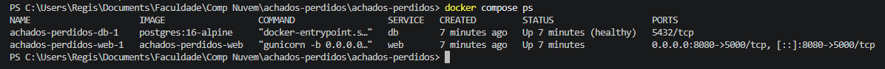

*docker compose ps com web em execução e db healthy.*
O web publica 8080→5000. O db mostra apenas 5432/tcp, sem mapeamento para o host: fica isolado na rede interna.

```
SERVICE  STATUS        PORTS
db       Up (healthy)  5432/tcp
web      Up            0.0.0.0:8080->5000/tcp, [::]:8080->5000/tcp
```

### Evidência 03_health
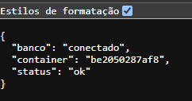

*GET /health retornando status ok e banco conectado.*
RF01. O web conseguiu conectar ao PostgreSQL usando o nome `db`.

### Evidência 04_itens
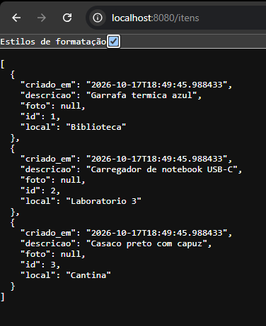

*GET /itens listando os 3 itens do init.sql.*
RF02. O `init.sql` criou a tabela `itens` e inseriu os 3 objetos de exemplo na primeira execução.

### Evidência 05_filtro_biblio
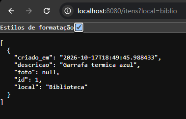

*GET /itens?local=biblio filtrando por local.*
RF02. O filtro devolve apenas o item cujo local contém "biblio" (Biblioteca).

### Evidência 07_estatisticas
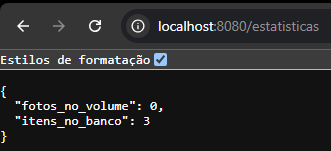

*GET /estatisticas no início: 3 itens e 0 fotos.*
RF04. Estado inicial, antes de cadastrar objetos com foto.

### Evidência 06_cadastro_foto
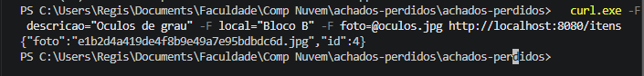
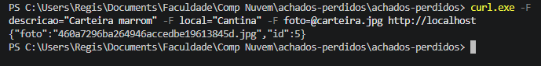

*POST /itens com foto retornando id e nome da foto.*
RF03. Dois objetos cadastrados com foto (`curl.exe`). A resposta traz o id e o nome gerado para a foto (uuid).

### Evidência 08_foto_navegador
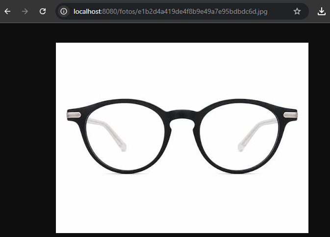 

*Fotos acessadas pela rota /fotos/&lt;nome&gt;.*
RF04. A rota devolve as imagens gravadas no volume `fotos`.

### Evidência 09_logs_web
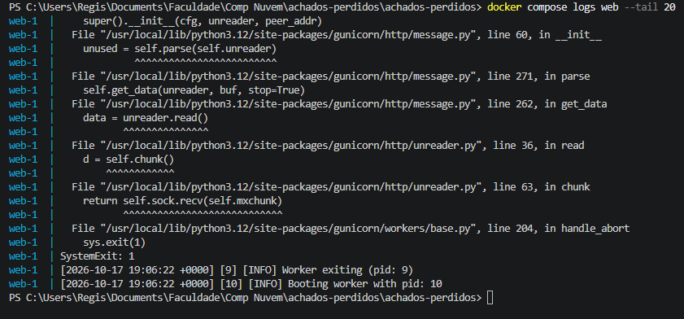

*Últimas 20 linhas de log do serviço web.*
O traceback é do Gunicorn reiniciando um worker (provável timeout de uma conexão ociosa do navegador). Um novo worker já aparece subindo (pid 10) e a aplicação continuou respondendo.

---

## 2. Prova de persistência (Tarefa 5)

### Situação 1 — Recriação dos contêineres (down + up)

#### Evidência 10_stats_antes
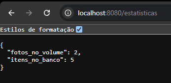

*Estatísticas antes do down: 5 itens, 2 fotos.*
Referência antes de recriar os contêineres.

#### Evidência 11_down_up
*docker compose down seguido de up -d (trecho; completo em [11_down_up.txt](achados-perdidos/docs/evidencias/11_down_up.txt)).*

```
$ docker compose down
Container achados-perdidos-web-1 Removed
Container achados-perdidos-db-1 Removed
Network achados-perdidos_rede_interna Removed
$ docker compose up -d
Container achados-perdidos-db-1 Healthy
Container achados-perdidos-web-1 Started
```
O `down` removeu contêineres e rede, mas nenhum volume (não aparece "Volume … Removed"). O `up` recriou tudo e só iniciou o web depois que o db ficou healthy.

#### Evidência 12_stats_depois
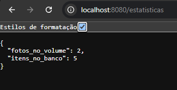

*Estatísticas depois do down/up: iguais às de antes.*
Continuam 5 itens e 2 fotos: os dados estavam nos volumes, não nos contêineres.

### Situação 2 — Inspeção dos volumes

#### Evidência 13_14_15
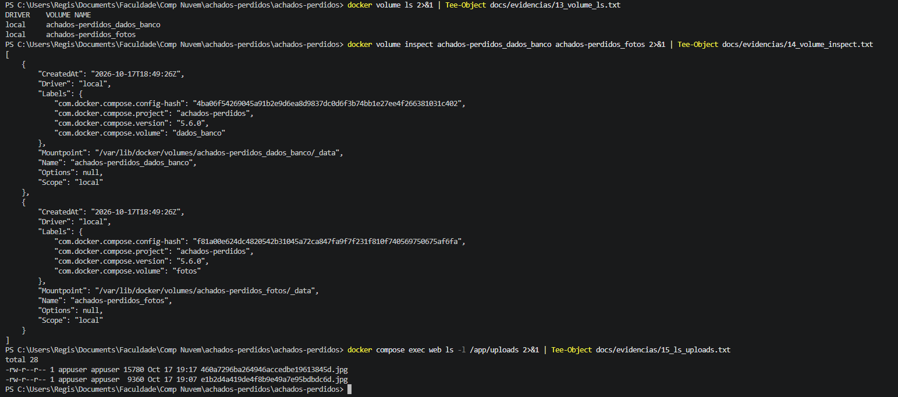

*docker volume ls, docker volume inspect e ls -l /app/uploads.*

```
dados_banco (Mountpoint):
  /var/lib/docker/volumes/achados-perdidos_dados_banco/_data
fotos (Mountpoint):
  /var/lib/docker/volumes/achados-perdidos_fotos/_data
$ docker compose exec web ls -l /app/uploads
-rw-r--r-- 1 appuser appuser 15780 ... 460a7296ba264946accedbe19613845d.jpg
-rw-r--r-- 1 appuser appuser  9360 ... e1b2d4a419de4f8b9e49a7e95bdbdc6d.jpg
```
Os dois volumes existem. Os dados ficam fisicamente no campo `Mountpoint`, dentro da máquina virtual do Docker (não numa pasta do Windows). As 2 fotos pertencem ao usuário `appuser`. Textos completos: [13](achados-perdidos/docs/evidencias/13_volume_ls.txt), [14](achados-perdidos/docs/evidencias/14_volume_inspect.txt) e [15](achados-perdidos/docs/evidencias/15_ls_uploads.txt).

### Situação 3 — Remoção dos volumes (down -v)

#### Evidência 16_down_v
*docker compose down -v removendo os volumes (trecho; completo em [16_down_v.txt](achados-perdidos/docs/evidencias/16_down_v.txt)).*

```
$ docker compose down -v
Volume achados-perdidos_dados_banco Removed
Volume achados-perdidos_fotos Removed
Network achados-perdidos_rede_interna Removed
$ docker volume ls
DRIVER    VOLUME NAME
```
Agora o `-v` removeu os dois volumes. O `docker volume ls` seguinte voltou vazio.

#### Evidência 17_stats_apos_down_v
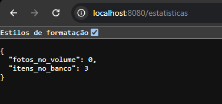

*Só os 3 itens do init.sql e 0 fotos.*
Os itens e as fotos cadastrados sumiram; voltaram apenas os 3 itens de exemplo.

#### Evidência 17_foto_404
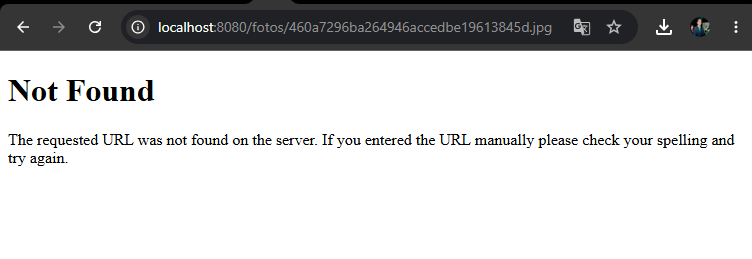

*A URL da foto antiga retorna 404 (Not Found).*
O arquivo foi apagado junto com o volume `fotos`.

**Por que isso aconteceu:**

- O `-v` apagou os volumes `dados_banco` e `fotos`; por isso os itens e as fotos sumiram.
- Com o `dados_banco` vazio, o PostgreSQL trata como primeira execução e roda o `init.sql` de novo, recriando os 3 itens de exemplo.

---

## 3. Evidências complementares (A4)

### Evidência 18_network_inspect
*docker network inspect da rede_interna (resumo; completo em [18_network_inspect.txt](achados-perdidos/docs/evidencias/18_network_inspect.txt)).*

```
Name:    achados-perdidos_rede_interna
Driver:  bridge          Subnet: 172.18.0.0/16
Containers:
  achados-perdidos-db-1    172.18.0.2/16
  achados-perdidos-web-1   172.18.0.3/16
```
Os dois contêineres estão na mesma rede bridge definida pelo usuário, e por isso o web encontra o db pelo nome.

### Evidência 19_image_ls
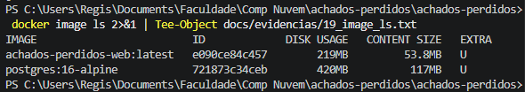

*docker image ls com o tamanho da imagem do web.*
A imagem `achados-perdidos-web` ocupa 219 MB em disco (53,8 MB de conteúdo), por usar `python:3.12-slim`.

### Evidência 20_whoami
*docker compose exec web whoami: processo rodando como appuser.*

```
$ docker compose exec web whoami
appuser
```
RNF04. O contêiner web não roda como root.

### Evidência 21_scale
*docker compose up -d --scale web=3: erro de porta em uso (completo em [21_scale.txt](achados-perdidos/docs/evidencias/21_scale.txt)).*

```
$ docker compose up -d --scale web=3
Error response from daemon: failed to set up container networking:
driver failed programming external connectivity on endpoint
achados-perdidos-web-3: Bind for 0.0.0.0:8080 failed: port is already allocated
```
Q7. Todas as réplicas tentam publicar a porta fixa 8080 do host, e só um contêiner pode usá-la. Para ter réplicas seria preciso remover a porta fixa e usar um proxy na frente.

---

## 4. Conclusão

- **Persistência:** itens e fotos sobrevivem a `down` + `up`, porque ficam nos volumes nomeados.
- **Destruição dos dados:** `down -v` apaga os volumes; o banco volta só com os dados do `init.sql`.
- **Segurança:** o banco não publica porta no host e o web roda como `appuser`.
