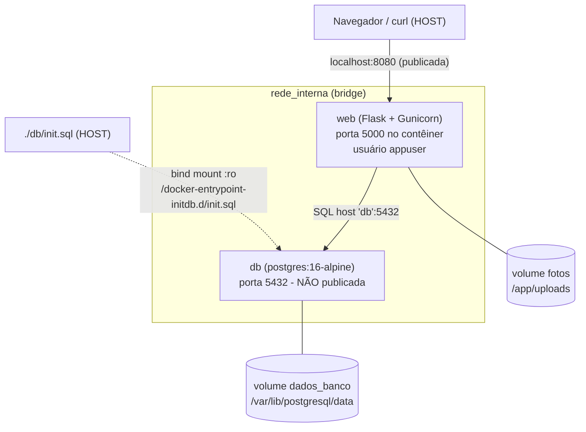

# Diagrama de arquitetura

- **Fora da rede interna:** o host (navegador/curl) e o arquivo `init.sql`.
- **Dentro da rede interna:** `web` e `db`.
- **Única porta publicada:** 8080 (host) → 5000 (web). O `db` não publica porta.
